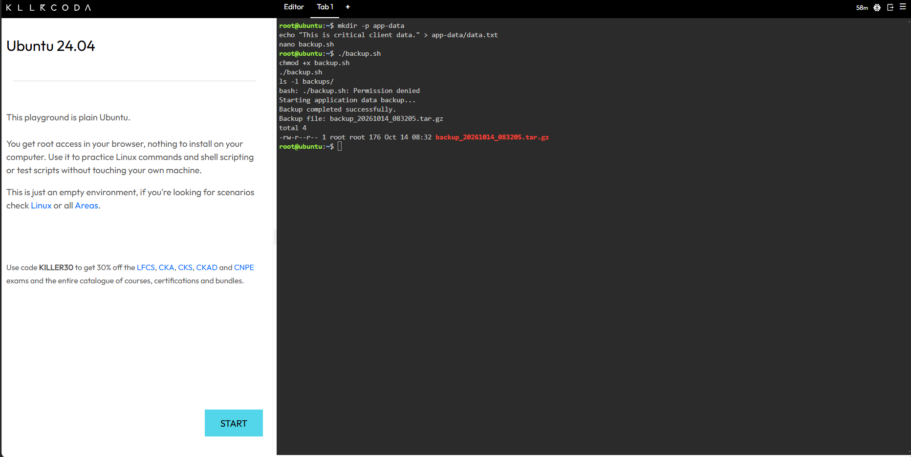
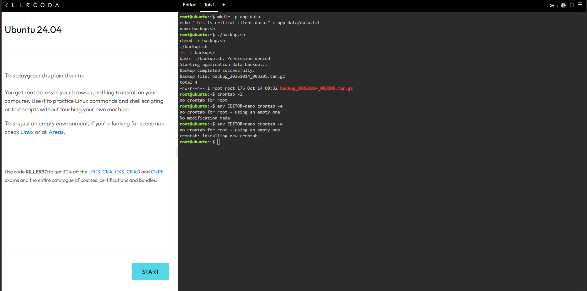

# Backup Script Technical Guide

## 1. Script Overview

The backup script automates the process of creating a compressed copy of the application data directory. It checks whether the source folder exists, creates the destination directory when needed, and generates a timestamped archive.

## 2. Complete Bash Script

```bash
#!/bin/bash

# CloudNova Automated Backup Script

SOURCE_DIR="app-data"
BACKUP_DIR="backups"
TIMESTAMP=$(date +"%Y%m%d_%H%M%S")

echo "Starting application data backup..."

if [ ! -d "$SOURCE_DIR" ]; then
    echo "Error: Source directory not found."
    exit 1
fi

mkdir -p "$BACKUP_DIR"

if tar -czf "$BACKUP_DIR/backup_$TIMESTAMP.tar.gz" "$SOURCE_DIR"; then
    echo "Backup completed successfully."
    echo "Backup file: backup_$TIMESTAMP.tar.gz"
else
    echo "Error: Backup creation failed."
    exit 1
fi
```

## 3. File Permissions

The command `chmod +x backup.sh` adds executable permission to the file. This allows me to run the script directly using `./backup.sh`, as long as I have the necessary access.

## 4. Cron Schedule

```cron
0 2 * * * /root/backup.sh
```

### Cron Field Explanation

| Field | Value | Description |
|---|---|---|
| Minute | `0` | Runs at minute zero |
| Hour | `2` | Runs at 2 AM |
| Day of Month | `*` | Runs on every day of the month |
| Month | `*` | Runs every month |
| Day of Week | `*` | Runs every day of the week |

This configuration schedules the script to run daily at 2:00 AM according to the system's local time.

## 5. Verification

I used `ls -l backups/` to check the generated archive and `crontab -l` to verify the installed schedule. The screenshots provide evidence of the commands and their output.

## 6. Screenshots

### Script Execution



### Cron Schedule



## 7. Backup Safety

Creating an archive is only the first step in a reliable backup process. Important backups should also be tested for restoration, stored separately from the original files, and checked regularly for errors.
